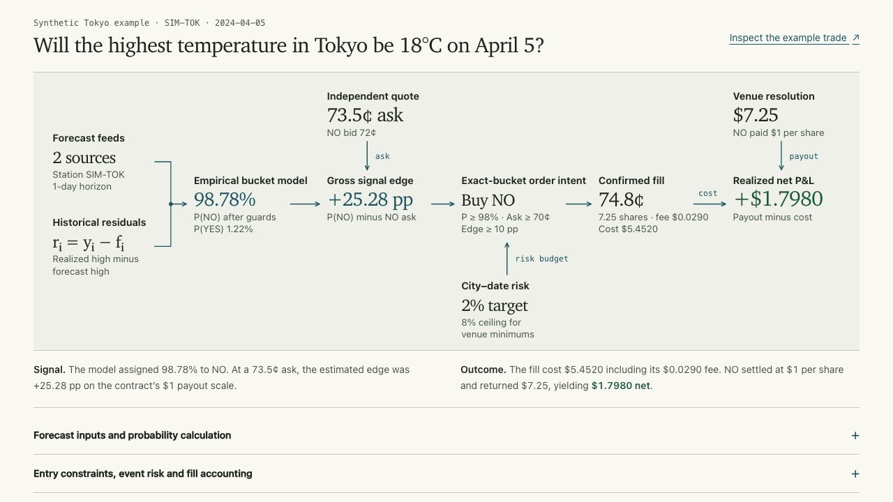

# DailyWeather

DailyWeather studies a pricing question in daily-high temperature markets. Given a weather forecast, what is the probability that a station's observed maximum will land in a particular contract bucket, and how does that probability compare with the available ask?

The Python package implements empirical forecast-error models, point-in-time evaluation, replay, and settlement audits. The [interactive showcase](showcase/README.md) follows a signal from forecast to fill to payout. Its public trade history is synthetic. The model validation figures come from an archived research evaluation.



## Research results

In the January–June 2026 outer tests, the selected model family scored **0.04111 Brier** against **0.05104** for the forecast baseline across 315,793 weather-label observations from 2,718 city–date clusters. On the separate market-payout dataset, the candidate scored **0.09316** and the market midpoint scored **0.07418**. Lower is better for both comparisons. The model met the two-score improvement criterion in 13 of 22 city holdouts and 2 of 3 regional holdouts, below the required 70% pass rate. [Aggregate results and evaluation design](showcase/public/model-evaluation.json)

## Explore the project

| Area | What to inspect |
| --- | --- |
| [Model and trader diagram](showcase/components/model-lab.tsx) | Forecasts and historical errors produce a bucket probability. An independent market quote enters at the edge calculation. |
| [Trade ledger](showcase/components/trade-explorer.tsx) | Inspect the purchased side, model probability, executable ask, fill, fees and eventual payout for an example position. |
| [Weather model](daily_weather_pipeline/weather_model_improvement.py) | Estimate bucket probabilities from historical residuals and shrink sparse groups toward broader evidence. |
| [Validation](daily_weather_pipeline/weather_model_validation.py) | Compare forecasts on held-out dates and distinguish repeated bucket observations from independent weather events. |
| [Signal and risk policy](daily_weather_pipeline/s01_parity_engine.py) | Check price eligibility, account for fills and size positions against joint city–date risk. |
| [Backtesting](daily_weather_pipeline/backtesting_engine.py) | Replay candidate rules against point-in-time market data. |
| [Tests](tests/) | Inspect the research invariants and run them offline. |

For a position with purchased-side probability *p* and ask *a*, the estimated gross edge is *p − a*. Realized P&L uses the actual execution price *x*, share count *q*, binary payout *Y*, and fee *F*: **q(Y − x) − F**.

## Run the showcase

With Node 22.13 or newer and npm:

```sh
cd showcase
npm ci
npm run dev
```

Open the localhost address printed by the development server. For a production build, run `npm run build` followed by `npm start`. The public example runs locally without credentials. [Showcase guide](showcase/README.md)

## Research package

Use Python 3.12 and install the package in a virtual environment:

```sh
python3.12 -m venv .venv
source .venv/bin/activate
python -m pip install .
python -m unittest discover -s tests
python -m daily_weather_pipeline --help
```

Archive-based commands accept locally supplied market and station data. Commands that use the legacy forecast loader also accept a separate `weather_strategy` checkout through `--source-repo`. See the [research guide](docs/RESEARCH.md), [project scope](docs/PROJECT_SCOPE.md), [data policy](docs/DATA_POLICY.md) and [security notes](docs/SECURITY.md) for data requirements and release boundaries.

Maintained by Ethan Wei.
